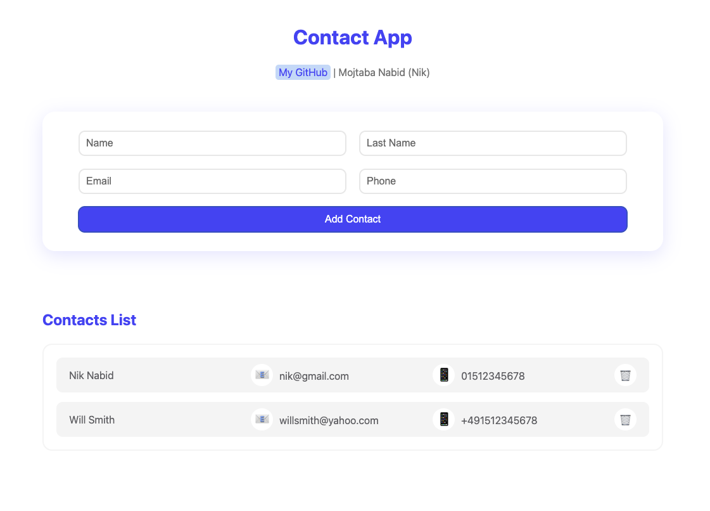

# Contact App

A practice project built with **React** and **Vite** to strengthen my React fundamentals and follow a more professional Git/GitHub development workflow.

The project focuses on component-based development, state and props, form handling, list rendering, conditional rendering, and iterative refactoring.



## Features

- Add contact information using:
  - First name
  - Last name
  - Email
  - Phone number
- Render contacts dynamically in a contact list
- Display an empty-state message when there are no contacts
- Organize UI logic into reusable React components
- Clean and simple user interface

## Tech Stack

- React
- JavaScript
- Vite
- CSS
- Git
- GitHub

## What I Am Practicing

This project is mainly a learning project. I am using it to improve my skills in:

- React components
- Props
- State management
- Controlled form inputs
- Rendering lists with `map()`
- Conditional rendering
- Component refactoring
- Git branches
- GitHub Issues
- Pull Requests
- Code review workflow

## Getting Started

Clone the repository:

```bash
git clone https://github.com/MojtabaNabid/contact-app.git
```

Go to the project directory:

```bash
cd contact-app
```

Install dependencies:

```bash
npm install
```

Start the development server:

```bash
npm run dev
```

Then open the local URL shown by Vite in your browser. By default, it is usually:

```text
http://localhost:5173/
```

## Development Workflow

For larger changes and features, I use a GitHub-style workflow:

```text
Issue
  ↓
Feature / Refactor Branch
  ↓
Development
  ↓
Commit & Push
  ↓
Pull Request
  ↓
Code Review
  ↓
Merge into main
```

This repository is also being used to practice a workflow similar to collaborative software development, even though the project itself is currently developed individually.

## Planned Improvements

- Form validation
- Edit contacts
- Search and filter contacts
- Persist contacts with Local Storage
- Improve accessibility
- Add automated tests
- Continue refactoring components as the project grows

## Repository

[github.com/MojtabaNabid/contact-app](https://github.com/MojtabaNabid/contact-app)

## Author

**Mojtaba Nabid (Nik)**  
GitHub: [@MojtabaNabid](https://github.com/MojtabaNabid)
